# Choosing an algorithm

All algorithms share one contract (an event-in, events-out function over projected run state), so they compose: a
`PlanAndExecute` executes steps with a `ToolLoop`, a `Router` delegates to any algorithm, a `Supervisor` coordinates
several. Start from the simplest one that fits.

```mermaid
flowchart TD
    Q{What decides<br/>the next step?}
    Q -->|The model, by calling my functions| T[ToolLoop]
    Q -->|The model, but it cannot do tool calling| R[ReAct]
    Q -->|A plan the model writes first| P[PlanAndExecute]
    Q -->|Me, in code| W{Cycles or long waits<br/>for outside events?}
    W -->|No: a DAG| WG[WorkflowGraph]
    W -->|Yes| F[FSM]
    Q -->|One of several specialists| RT[Router]
    Q -->|Several specialists at once| SV[Supervisor]
    Q -->|I can check the output| V{With code or with a model?}
    V -->|Code: schema, tests, rules| G[GenerateTestRepair]
    V -->|Another model| C[GeneratorCritic]
    Q -->|Same question, vote| S[SelfConsistency]
    Q -->|Answer from my documents| RG[RAGAgent]
    Q -->|Learn from failed attempts| RF[Reflexion]
    Q -->|Several views, then a ruling| DB[Debate]
    Q -->|Hand off between specialists| SW[Swarm]
    Q -->|Search over reasoning steps| TT[TreeOfThoughts]
    Q -->|Check or improve a draft| VF{How?}
    VF -->|Critique itself| SRF[SelfRefine]
    VF -->|Fact-check questions| COV[ChainOfVerification]
    VF -->|Score N samples| BON[BestOfN]
    Q -->|Plan every tool call first| PF{Can it react?}
    PF -->|No: cheapest| RW[ReWOO]
    PF -->|Yes: a joiner may replan| LC[LLMCompiler]
    Q -->|Act on a screen or a site| CU[ComputerUse]
    Q -->|Compute with code| CA[CodeAct]
    Q -->|Cheap first, escalate if the budget allows| AT[Anytime]
    Q -->|Several agents together| MA{How do they coordinate?}
    MA -->|Layers refine each other's answers| MOA[MixtureOfAgents]
    MA -->|Shared board, a chair picks who writes| BB[Blackboard]
    MA -->|They bid, the best bid wins| AU[Auction]
    MA -->|Roles hand over typed documents| SOP[RolePlaySOP]
    Q -->|It may need to ask a person| AH[AskHuman]
    Q -->|Learn and reuse what worked| LR{What?}
    LR -->|Verified code skills| VY[VoyagerAgent]
    LR -->|Insights from recent memories| MR[MemoryReflection]
    LR -->|The model manages its own memory| SM[SelfManagedMemory]
    LR -->|A better prompt, from evals| OP[aaa.optimize]
    Q -->|Answer from my documents, checked| RC{What matters?}
    RC -->|Grade passages, fall back to web| CRG[CorrectiveRAG]
    RC -->|One answer per passage, judge support| SRG[SelfRAG]
    RC -->|Match retrieval to the question| ARG[AdaptiveRAG]
    Q -->|Specialist workers, each with a budget| HA[HierarchicalAgent]
    Q -->|Break the question down| DC{How?}
    DC -->|Easy sub-questions first| L2M[LeastToMost]
    DC -->|Ask follow-ups, maybe a tool| SA[SelfAsk]
    Q -->|Merge and refine thoughts| GOT[GraphOfThoughts]
    Q -->|Tree search with lessons| LT[LATS]
```

## At a glance

| Algorithm | Control flow decided by | LLM calls | Key knobs | Result `value` |
|---|---|---|---|---|
| [`ToolLoop`](tool-loop-react.md) | the model | 1 per turn | `max_turns`, `tool_names`, `system`, `stream` | `{"text", "turns"}` |
| [`ReAct`](tool-loop-react.md) | the model (text protocol) | 1 per turn | same | `{"text", "turns"}` |
| [`PlanAndExecute`](plan-and-execute.md) | model plans, code schedules | plan + per-step + synthesis | `executor`, `max_parallel`, `max_replans`, `synthesize`, `review_progress` | `{"text", "results"}` |
| [`Router`](router-supervisor.md) | rules, then optionally the model | 0 or 1 | `classifier`, `default`, routes | the chosen child's value |
| [`Supervisor`](router-supervisor.md) | the model, via delegate tools | per turn + workers | `workers`, `extra_tools` | `{"text", "turns"}` |
| [`GenerateTestRepair`](refine.md) | your validator | 1 per attempt | `validator`, `max_iterations` | `{"candidate", "iterations"}` |
| [`GeneratorCritic`](refine.md) | a critic model | 2 per attempt | `critic_model`, `max_iterations` | `{"candidate", "iterations"}` |
| [`WorkflowGraph`](workflow-fsm.md) | your DAG | 0 | nodes, `output` | the output node's result |
| [`FSM`](workflow-fsm.md) | your transition table + events | 0 | `transitions`, `terminal`, `on_enter` | `{"state", "path"}` |
| [`SelfConsistency`](ensembles-rag.md) | vote | `n` in parallel | `n`, `temperature`, `extract` | `{"answer", "votes", "samples", "agreement"}` |
| [`RAGAgent`](ensembles-rag.md) | the model | per turn | `index`, `k` | `{"text", "turns"}` |
| [`Reflexion`](reasoning.md) | your validator or a critic | attempt + evaluation + reflection per trial | `validator`, `max_trials` | `{"candidate", "trials", "reflections"}` |
| [`Debate`](reasoning.md) | vote or a judge | `agents * (rounds + 1)` (+1) | `agents`, `rounds`, `judge`, `personas` | `{"answer", "rounds", "agents", "answers", "judged"}` |
| [`Swarm`](reasoning.md) | the model, via transfer tools | per turn | `agents`, `start`, `max_handoffs` | `{"text", "turns", "agent", "handoffs"}` |
| [`ComputerUse`](environments.md) | the model, one action at a time, with stop rules | `max_steps + 1` | `env`, `max_steps`, `max_repeats`, `stall_limit` | `{"answer", "steps", "stopped"}` |
| [`CodeAct`](environments.md) | the model, as Python run in a sandbox | `max_steps + 1` | `sandbox`, `max_steps`, `requires_approval` | `{"answer", "steps", "turns"}` |
| [`Anytime`](environments.md) | a ladder of your algorithms, budget-aware | the rungs' | `ladder`, `accept` | `{"value", "rung", "tried", "degraded", "stopped"}` |
| [`MixtureOfAgents`](multi-agent-human.md) | layers, then an aggregator | `proposers * layers + 1` | `proposers`, `layers`, `personas`, `models` | `{"answer", "layers"}` |
| [`Blackboard`](multi-agent-human.md) | a chair model, among your experts | `2 * max_rounds + 1` at most | `experts`, `max_rounds` | `{"answer", "board", "rounds"}` |
| [`Auction`](multi-agent-human.md) | bids, awarded by a rule in code | one bid per worker + the winner's run | `workers`, `rule`, `fallback`, `child_budget` | `{"text", "winner", "tried", "bids"}` |
| [`RolePlaySOP`](multi-agent-human.md) | your roles and their document types | `roles * (repairs + 1)` at most | `roles`, `max_repairs` | `{"document", "documents", "roles", "repairs"}` |
| [`AskHuman`](multi-agent-human.md) | the model, and a person | `max_questions + 1` at most | `max_questions` | `{"answer", "questions", "asked"}` |
| [`VoyagerAgent`](memory-self-improvement.md) | the model, with verified skills | per turn | `library`, `requires_approval`, `max_turns` | `{"text", "turns"}` |
| [`MemoryReflection`](memory-self-improvement.md) | an importance threshold, then the model | `window + 1 + questions` at most | `window`, `threshold`, `questions` | `{"reflected", "importance", "questions", "insights", "written"}` |
| [`SelfManagedMemory`](memory-self-improvement.md) | the model, via memory tools | per turn | `blocks`, `extra_tools` | `{"text", "turns"}` |
| [`CorrectiveRAG`](rag-checked.md) | grades per passage | `(rewrites + 1) * k + rewrites + k + 1` at most | `index`, `k`, `web_tool`, `min_relevant`, `max_rewrites` | `{"text", "sources", "queries", "route", "graded"}` |
| [`SelfRAG`](rag-checked.md) | per-passage judgments | `adaptive + 2 * candidates * (rewrites + 1) + rewrites` at most | `adaptive`, `max_candidates`, `max_rewrites` | `{"text", "source", "supported", "useful", "queries", "rounds", "route"}` |
| [`AdaptiveRAG`](rag-checked.md) | a routing call | `max_hops + 2` at most | `max_hops` | `{"text", "route", "hops", "sources", "queries"}` |
| [`ReWOO`](plan-first.md) | a plan checked before it runs | 2 | `tool_names`, `max_steps`, `on_step_error` | `{"text", "plan", "evidence", "rounds"}` |
| [`LLMCompiler`](plan-first.md) | a plan checked before it runs, then a joiner | `2 * (max_replans + 1)` | same, `max_replans` | `{"text", "plan", "evidence", "rounds"}` |
| [`HierarchicalAgent`](plan-first.md) | a manager's validated sub-goal DAG | manager + workers | `workers`, `max_subgoals`, `max_depth`, `child_budget` | `{"text", "subgoals", "depth"}` |
| [`SelfRefine`](verify-search.md) | the model critiques itself | `2 * rounds + 2` at most | `max_rounds` | `{"answer", "rounds", "stopped"}` |
| [`ChainOfVerification`](verify-search.md) | independent check questions | `3 + max_questions` at most | `max_questions` | `{"answer", "draft", "checks", "revised"}` |
| [`BestOfN`](verify-search.md) | a verifier (code, tool or model) | `n` (+ `n` judge calls) | `n`, `score`, `verifier_tool`, `threshold` | `{"answer", "score", "scores", "selected", "n", "early_stop"}` |
| [`LeastToMost`](verify-search.md) | the model, sub-question by sub-question | `max_subquestions + 2` at most | `max_subquestions` | `{"answer", "steps"}` |
| [`SelfAsk`](verify-search.md) | the model, via follow-ups | up to `2 * max_followups + 1` | `max_followups`, `lookup_tool` | `{"answer", "followups", "turns"}` |
| [`GraphOfThoughts`](verify-search.md) | your graph of operations | known up front (`max_calls`) | `ops` | `{"answer", "score", "thoughts", "operations"}` |
| [`LATS`](verify-search.md) | UCT and scores, in code | up to `3 * iterations * branching` | `iterations`, `branching`, `depth_limit`, `solved_score` | `{"answer", "score", "path", "solved", ...}` |
| [`TreeOfThoughts`](reasoning.md) | scores, in code | up to `2 * depth * width * branching` | `depth`, `width`, `branching`, `stop_score` | `{"answer", "score", "path", "depth", "explored"}` |

## Rules of thumb

- **Prefer determinism you can have.** If the steps are known, a `WorkflowGraph` is cheaper, faster and more
  predictable than asking a model to rediscover them. Use the LLM where judgement is needed and code elsewhere.
- **Verify with code before verifying with a model.** `GenerateTestRepair` with a real check (a schema, a unit test,
  a business rule) beats `GeneratorCritic` whenever you *can* write the check.
- **A model checking itself is weak evidence.** `SelfRefine` shares the writer's blind spots; `ChainOfVerification` is better at facts
  because the checks are answered without the draft in view; `BestOfN` with a code or tool verifier is better still.
- **Voting is for exact answers.** `SelfConsistency` helps when answers can be compared (numbers, labels, extracted
  fields). It does not help with free-form prose.
- **Plans cost latency.** `PlanAndExecute` pays for planning and synthesis calls. It earns that back when steps run in
  parallel or are long; for a two-tool task a `ToolLoop` is better.
- **Cap everything.** Give every algorithm a `Budget`, and `max_turns`/`max_iterations` where offered. Loops that can
  run forever eventually will.

## Common to all

- Input is a dict. The built-ins read `task` (a string); `ToolLoop`/`ReAct` also accept `messages` (a full message list
  in the `Message` shape) for complete control of the starting conversation.
- Pass `model=` to choose a model per algorithm, and `params={"temperature": 0, ...}` for request parameters.
- Each algorithm's `name` must be **unique** within an engine's cluster (it is how runs are routed). `ToolLoop(..., name="billing")`
  renames an instance.
- Every outcome kind is possible; see [Outcomes and errors](../../reference/outcomes-and-errors.md).
