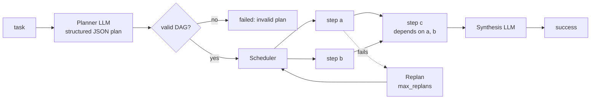

# PlanAndExecute

Ask the model for a **plan** (a dependency graph of steps), run the steps as **parallel child runs**, repair the plan if
a step fails, then **synthesize** a final answer.

```python
class PlanAndExecute:
    def __init__(
        self,
        executor,
        *,
        model=None,
        max_parallel=3,
        max_replans=1,
        synthesize=True,
        planner_system=...,
    ): ...
```

```python
--8<-- "examples/plan_and_execute.py"
```

```text
Tokyo + Delhi = 46 million people
steps run: ['a', 'b', 'c']
```

## How it works



1. **Plan.** One LLM call with a JSON schema asks for `{"steps": [{"id", "description", "depends_on": []}]}`.
2. **Validate.** Duplicate ids, unknown dependencies and cycles are rejected (`failed`, reason `invalid plan: ...`).
   A plan is code-checked before any step runs.
3. **Execute.** Ready steps (all dependencies done) start as **child runs of `executor`** (any algorithm, typically a
   `ToolLoop`), at most `max_parallel` at once. Each child receives the overall task, its step, and the results of its prerequisites.
4. **Replan.** If a step fails and replans remain, the planner is asked for the *remaining* steps given what is
   done and what failed. New step ids get an `r<n>-` prefix. Beyond `max_replans`, the run fails with the failing step's reason.
5. **Synthesize.** One more call combines all step results into the answer.

The plan itself is in the log (`aaa.plan.created`, `aaa.plan.revised`, `aaa.task.started`), so it is inspectable,
resumable and replayable.

## Parameters

| Parameter | Default | |
|---|---|---|
| `executor` | required | The algorithm that runs each step. Its `name` must be unique and registered on every worker. |
| `model` | `None` | Model for planning and synthesis. |
| `max_parallel` | `3` | Concurrent step runs. |
| `max_replans` | `1` | How many times a failure may trigger replanning. `0` disables. |
| `synthesize` | `True` | `False` skips the final call and returns `{"results": {...}}`. |
| `planner_system` | built-in | Override the planner prompt. Keep the JSON shape. |

**Result:** `{"text": <synthesis>, "results": {step_id: result}}`.

## Budgets and children

Child runs have their own outcomes and their **spend rolls up** into the parent's budget, so one
`Budget(max_cost=1.0)` on the parent bounds the whole tree. If the parent finishes or is cancelled, running children are cancelled.

## When not to use it

For a task needing two or three tool calls in sequence, a `ToolLoop` is simpler and cheaper: planning and synthesis add
two LLM calls. Choose `PlanAndExecute` when steps are independent and can run in parallel, are individually long, or when
you want the plan itself as an auditable artifact.

## Reviewing the plan as it goes

`PlanAndExecute(..., review_progress=True)` also asks the planner, after each finished step, whether the remaining steps still hold. See [Plan-first and delegating algorithms](plan-first.md#planandexecutereview_progresstrue).
