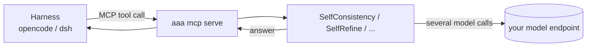

# Using AAA from a coding harness

A coding harness such as [opencode](https://opencode.ai) or [DeepSeek Harness](https://composio.dev/blog/how-to-connect-mcp-servers-to-deepseek-harness) (`dsh`) runs its own agent loop with its own model. AAA does not replace that loop (there is no chat-completions endpoint to point a harness at). What it can do is sit **underneath** it: you expose AAA algorithms as MCP tools, and the harness's model calls them when a question deserves more than one pass. The algorithm then spends its own model calls, on whichever model you configure for it, which can be a cheaper or local one.



!!! warning "What was and was not tested"
    The AAA side is tested: the example below was run through a real MCP client (the MCP SDK's stdio client), which listed both tools and got the right answer from `careful_answer` against a local Qwen3-4B. The harness side was **not** run: the opencode and DeepSeek Harness snippets follow their published documentation ([opencode](https://opencode.ai/docs/mcp-servers/), [dsh via Composio's guide](https://composio.dev/blog/how-to-connect-mcp-servers-to-deepseek-harness)), and I could not check them against the tools. The `dsh` format in particular comes from a third-party guide; check it against `dsh web --dump-config`. The HTTP variants were not run either.

## 1. The tools

The example lives in `examples/harness/`:

* `agents.py` defines the algorithms (`SelfConsistency(5)`, `SelfRefine(max_rounds=2)`) and an `engine()` that wires a model endpoint from three environment variables: `AAA_BASE_URL`, `AAA_MODEL` and an optional `AAA_API_KEY`. Point them at DeepSeek's API, a gateway, or a local server.
* `aaa-mcp.toml` turns each algorithm into one tool with its own description, input schema and **mandatory deadline** (the harness cannot approve a paused run, so a run that waits on a human would otherwise wait forever):

```toml
version = 1

[server]
name = "aaa-algos"

[runtime]
engine = "agents:engine"

[[agents]]
name = "careful_answer"
algorithm = "agents:careful"
description = "Answer a question that has one checkable answer ... by sampling five reasoning attempts and taking the majority."
output = "text"
input_template = { task = "{question}" }

[agents.budget]
deadline_s = 120
max_steps = 12

[agents.input_schema]
type = "object"
required = ["question"]
additionalProperties = false
properties = { question = { type = "string" } }
```

Write the **description for the model that will read it**: it decides from this text whether to call the tool. Say what kind of question it is for and what it costs. See [Generating an MCP server](mcp-generator.md#algorithms-as-tools) for every option (budgets, concurrency cap, profiles, input templates).

Try it without any harness:

```bash
cd examples/harness
chmod 600 aaa-mcp.toml                      # a config that others can write to is refused
PYTHONPATH=. aaa mcp serve --config aaa-mcp.toml
```

## 2. opencode

Add the server under the `mcp` key of `opencode.json` (project) or your global config. `examples/harness/opencode.json`:

```json
{
  "$schema": "https://opencode.ai/config.json",
  "mcp": {
    "aaa": {
      "type": "local",
      "command": ["aaa", "mcp", "serve", "--config", "/ABSOLUTE/PATH/TO/examples/harness/aaa-mcp.toml"],
      "environment": {
        "PYTHONPATH": "/ABSOLUTE/PATH/TO/examples/harness",
        "AAA_BASE_URL": "http://localhost:8001/v1",
        "AAA_MODEL": "mlx-community--Qwen3-4B-Instruct-2507-4bit"
      },
      "enabled": true,
      "timeout": 15000
    }
  }
}
```

* `command` is an array and the working directory is the workspace unless you set `cwd`, so use absolute paths. The `aaa` executable must be on the `PATH` opencode sees (install with `pip install "autonomous-agent-architecture[mcp]"` into the environment opencode launches from, or give the full path to the executable).
* opencode prefixes tool names with the server name, so the model sees `aaa_careful_answer` and `aaa_polish_text`. To turn them off for a session: `"tools": { "aaa_*": false }`.
* `timeout` is how long opencode waits for the **tool list** (default 5 seconds; starting Python and the engine can exceed that, hence 15 s). The time a call may take is set by the tool's `deadline_s` in the AAA config.
* To tell the model when to use them, add a line to `AGENTS.md`, for example: *"For arithmetic or a factual question with one right answer, call `aaa_careful_answer` instead of answering directly."*

**Remote server.** Behind [`aaa-server`](../server/index.md), `POST /mcp` serves the same tools under the server's authentication. `examples/harness/opencode-http.json`:

```json
{
  "mcp": {
    "aaa": {
      "type": "remote",
      "url": "https://aaa.example.com/mcp",
      "headers": { "Authorization": "Bearer {env:AAA_SERVER_KEY}" },
      "oauth": false
    }
  }
}
```

`"oauth": false` stops opencode from starting an OAuth flow, since the server uses an API key.

## 3. DeepSeek Harness (`dsh`)

`dsh` mounts MCP servers as patches in `~/.dsh/profiles/web/cordis.patch.yml`. `examples/harness/dsh-cordis.patch.yml`:

```yaml
- insert:
    - id: mcp-aaa
      name: '@deepseek-ai/dsh-mcp-client'
      config:
        serverName: aaa
        transport: stdio
        command: aaa
        args: ['mcp', 'serve', '--config', '/ABSOLUTE/PATH/TO/examples/harness/aaa-mcp.toml']
        cwd: /ABSOLUTE/PATH/TO/examples/harness
        env:
          PYTHONPATH: /ABSOLUTE/PATH/TO/examples/harness
          AAA_BASE_URL: http://localhost:8001/v1
          AAA_MODEL: mlx-community--Qwen3-4B-Instruct-2507-4bit
          AAA_API_KEY: !!js process.env.AAA_API_KEY
        toolCallTimeoutMs: 180000
```

* The tools appear as `mcp__aaa__careful_answer` and `mcp__aaa__polish_text`. `serverName` must be 1 to 32 letters, digits, `_` or `-`.
* `!!js process.env.X` reads a value from the environment when the harness loads, which keeps a key out of the file. Export it in the shell that launches `dsh`.
* `toolCallTimeoutMs` defaults to 60 seconds; a five-sample algorithm on a slow model needs more.
* Check it loaded: `dsh web --dump-config | grep -A3 mcp`, and look for `mcp__aaa__` in the session log.
* Use DeepSeek's own API for the algorithms too by setting `AAA_BASE_URL` to its OpenAI-compatible endpoint, `AAA_MODEL` to the model name and `AAA_API_KEY` in the environment. Check the base URL and model names against DeepSeek's current documentation; they change.

**Remote server.** `examples/harness/dsh-cordis-http.patch.yml` uses `transport: streamable-http`, `url` and a static `Authorization` header. `dsh`'s MCP client has no OAuth, so use an API key (an `aaa-server` key) rather than an OAuth token.

## 4. Which algorithms to expose, and what they cost

Expose few tools, each for a case where the benchmarks showed extra calls paying off. A harness model that sees ten overlapping tools will pick badly, and each call spends real model time. From the [benchmarks](algorithms/benchmarks.md) (small local models, so treat as a guide):

| Expose | When the harness should call it | Cost per call |
|---|---|---|
| `SelfConsistency` | arithmetic or a question with one checkable answer, when a wrong answer is expensive | about 5 model calls |
| `CodeAct` (with a real [sandbox](../security/algorithms.md)) | the answer is a computation | 1 to 4 calls plus the code run |
| `CorrectiveRAG` over your documents | questions about your own docs, where "not in the documents" is a valid answer | about 7 to 9 calls |
| `SelfRefine` | text that should be better than a first draft | 2 to 5 calls |

On easy tasks a single call matched the multi-call algorithms, so tell the model in the tool description to use the tool only when it is unsure.

## 5. Safety

* **The harness's model chooses to call a tool, and its arguments may come from files or web pages it read.** Treat the arguments as untrusted: keep each tool's input schema tight (`additionalProperties = false`, typed fields), and never give an exposed algorithm tools you would not give to that model directly.
* **Budgets are the spending limit.** `deadline_s` is required, and `max_steps`, `max_tokens` or `max_cost` bound the rest. `[limits] max_concurrent_agents` caps parallel runs so a looping harness cannot queue unlimited model spend.
* **The tenant and user come from the host, not the arguments.** On stdio they are fixed in the configuration (`[tenancy]`); behind `aaa-server` they come from the authenticated key, so one harness user cannot read another's memory or runs.
* **Code-running algorithms need a real sandbox.** `CodeAct` needs a sandbox and, by default, approval, but MCP cannot ask a human. Expose it only with a container sandbox (`DockerSandbox`), never `SubprocessSandbox(unsafe=True)`, which is only for a throwaway local trial.
* **Secrets stay in the environment.** The config file refers to nothing secret; keys are passed through `environment` / `env` or the shell. A configuration writable by other users is refused at startup.
